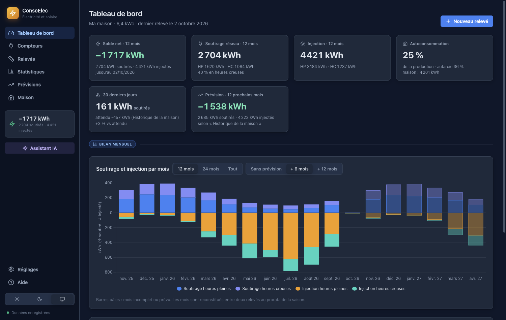

# ConsoElec

Application de bureau (**Angular 21 + Electron**) pour suivre la consommation et la production d'électricité d'une maison belge équipée de panneaux solaires :

- **Compteur intelligent** : les quatre index (soutirage et injection, heures pleines et creuses) saisis à la main ou lus par Claude sur une **photo** du compteur ; vue détaillée des quatre sous-compteurs.
- **Statistiques** par mois, par saison et par année, avec comparaison à une maison belge type (la chaudière au mazout et le poêle à bois ne consomment pas d'électricité).
- **Installation solaire** : panneaux, onduleur (écrêtage), radiateur d'appoint sur le surplus ; si l'index de production est encodé, autoconsommation, autarcie et consommation réelle de la maison.
- **Prévisions** selon la saison : statistique belge, statistique recalée sur la maison (avec prudence quand les données sont courtes), historique réel ; fiabilité mesurée par rétro-test sur les mois passés. Scénario **voiture électrique** (avec / sans).
- **Plusieurs ordinateurs** : export JSON, puis import qui fusionne. Seuls les relevés absents sont ajoutés ; rien n'est modifié ni supprimé. Export et import CSV des relevés (Excel).
- **Assistant IA** : panneau Claude qui voit toutes les données (clé API chiffrée par le système, jamais exposée à la page).
- Thèmes **clair / sombre / système**, interface en CSS natif, sans bibliothèque de composants.

Le mode d'emploi complet est dans **[docs/GUIDE-UTILISATEUR.md](docs/GUIDE-UTILISATEUR.md)**. Il est aussi lisible dans l'application, page *Aide*.



## Démarrage

Il faut Node.js 22.12 ou plus récent.

```bash
npm install
npm run dev          # Angular (http://localhost:4200) + Electron avec rechargement
npm run start:prod   # build de production puis lancement d'Electron
npm test             # tests unitaires : Vitest (Angular) puis Vitest (process principal)
```

`npm run dev:ng` lance seulement l'interface dans un navigateur. Sans Electron, les données sont alors conservées dans le `localStorage` du navigateur, et l'assistant IA ainsi que la lecture de photo sont désactivés.

Un fichier `.npmrc` local force le registre public `registry.npmjs.org`.

## Construire les installeurs

```bash
./release/build.sh       # release/consoelec-<version>-mac-arm64.dmg (macOS uniquement)
./release/build-win.sh   # release/consoelec-<version>-win-x64.exe (installeur NSIS)
```

Les scripts lancent `npm ci` si les dépendances manquent ou sont périmées, puis les tests, puis `npm run dist:mac` ou `npm run dist:win`.

- L'installeur Windows se construit depuis un Mac sans Wine. Sur Apple Silicon, il faut Rosetta 2 : `softwareupdate --install-rosetta --agree-to-license`.
- Sur un PC Windows, lancer directement `npm ci && npm run dist:win`.
- La configuration est dans [`electron-builder.yml`](electron-builder.yml) et les icônes dans [`build/`](build).

Les paquets ne sont pas signés. Sur macOS, lever la quarantaine avec `xattr -dr com.apple.quarantine /Applications/ConsoElec.app`. Sur Windows, SmartScreen demande « Exécuter quand même ».

## Architecture

```
electron/                  Process principal (TypeScript → dist-electron/)
  main.ts                  fenêtre durcie, protocole app://, IPC validé, thème natif
  preload.ts               pont contextBridge → window.consoElec
  storage.ts               fichier JSON (écriture atomique + copie .bak)
  secrets.ts               clé API chiffrée par safeStorage (fichier séparé des données)
  ai-core.ts               API Claude : requêtes, flux SSE, outil de lecture de photo, erreurs (pur, testé)
  ai.ts                    appels réseau depuis le process principal uniquement
  image.ts                 conversion d'image en JPEG (HEIC des iPhone via sips sur macOS)
  shared/ipc-contract.ts   types partagés avec l'interface
src/app/
  core/models/             modèle de données, validation et fusion des fichiers importés (merge.ts)
  core/calc/               calculs purs et testés :
    solar.ts                 hypothèses solaires : jour, météo, courbe horaire
    reference.ts             modèle horaire de la maison : consommation, production, écrêtage, radiateur, HP/HC
    house-simulator.ts       maison simulée jour par jour (vérité terrain des tests, données de démo)
    backtest.ts              fiabilité des prévisions sur les mois passés
    consumption.ts           intervalles entre relevés, anomalies, répartition journalière saisonnière
    stats.ts                 indicateurs, tableaux annuels, moyennes mensuelles, saisons
    forecast.ts              profils de prévision et projection des quatre index
    ev.ts                    effet d'une voiture électrique sur chaque registre
    analysis.ts              assemblage complet utilisé par l'interface
    csv.ts, csv-import.ts    export et import CSV des relevés
  core/ai/                 contexte envoyé à Claude (instantané des données), service de conversation
  core/services/           DataStore (signals + sauvegarde auto), stockage, thème, toasts
  shared/                  icônes SVG, enveloppe Chart.js, panneau de l'assistant, lecture des photos
  pages/                   tableau de bord, compteurs, relevés, statistiques, prévisions, maison, réglages, aide
docs/                      guide utilisateur (embarqué dans l'app) et captures d'écran
release/                   scripts de build .dmg / .exe
```

### Données

Toutes les données sont dans un seul fichier JSON :

- macOS : `~/Library/Application Support/ConsoElec/consoelec.json`
- Windows : `%APPDATA%\ConsoElec\consoelec.json`

La clé API Claude est dans `secrets.bin`, à côté, chiffrée par le système : elle n'est ni exportée ni synchronisée.

En développement, `CONSOELEC_USER_DATA=/un/dossier` isole les données. `CONSOELEC_API_URL=http://127.0.0.1:…/v1/messages` redirige les appels Claude vers un serveur de test local (ignoré dans l'application packagée).

### Les quatre index du compteur

Un relevé contient les quatre index cumulés en kWh : soutirage heures pleines (1.8.1) et creuses (1.8.2), injection heures pleines (2.8.1) et creuses (2.8.2), plus, en option, l'index de production solaire de l'onduleur. La consommation entre deux relevés est la différence des index. Elle est répartie jour par jour au prorata d'un poids saisonnier propre à chaque registre (soutirage : consommation avec part hivernale ; injection et production : profil solaire), de sorte que les totaux mensuels restent réalistes même avec des relevés espacés. Un mois n'entre dans les moyennes que s'il est entièrement couvert.

### Données de référence

- Consommation annuelle de référence : 3 500 kWh/an pour 4 personnes sans chauffage électrique (réglable ; la VREG cite 3 305 kWh en moyenne en Flandre, les comparateurs 3 200 à 3 500 kWh pour 3 à 4 personnes).
- Production : 850 kWh/kWc/an (Bruxelles Environnement : 840 kWh/kWc, plein sud à 35°) répartis selon un profil mensuel de type PVGIS.
- Saisonnalité de la consommation : degrés-jours 15/15 normaux à Uccle (IRM).

Ce sont des ordres de grandeur, tous modifiables dans les réglages.
