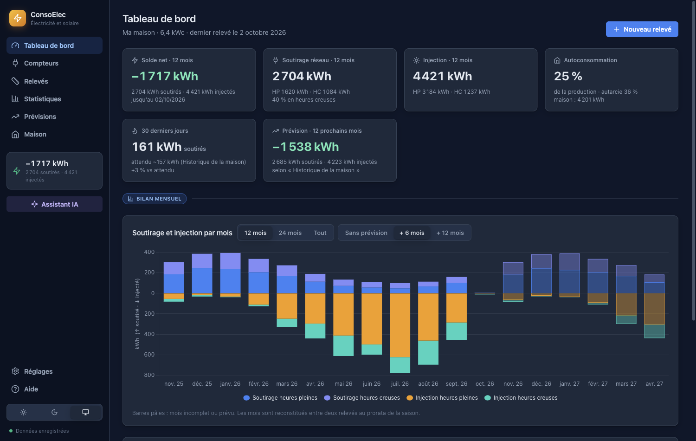
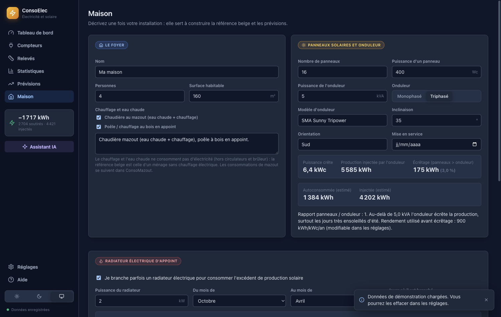
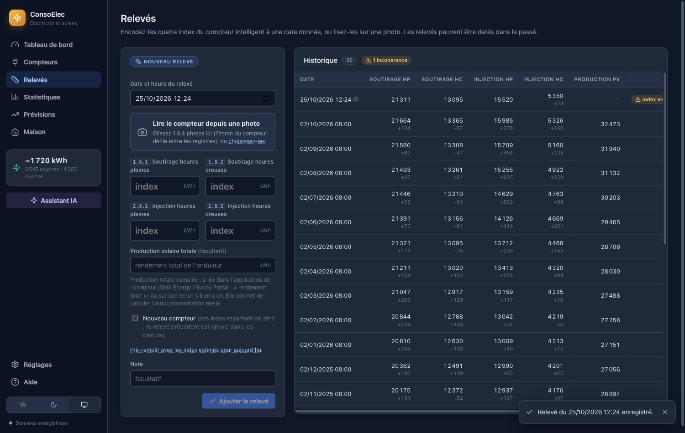
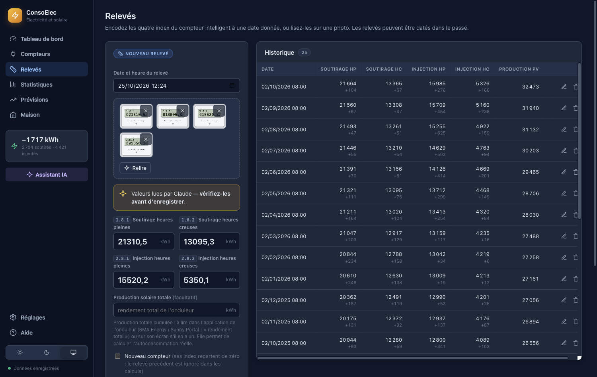
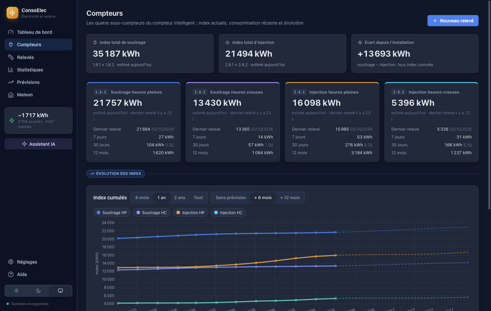
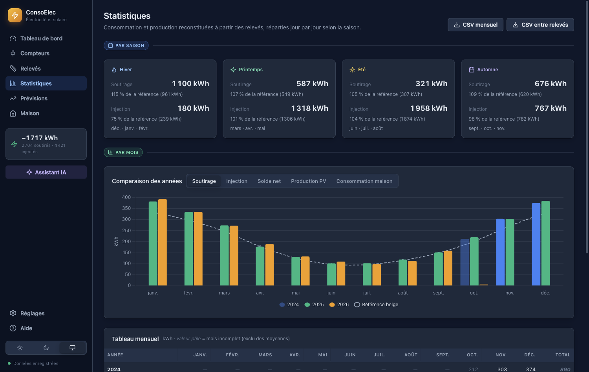
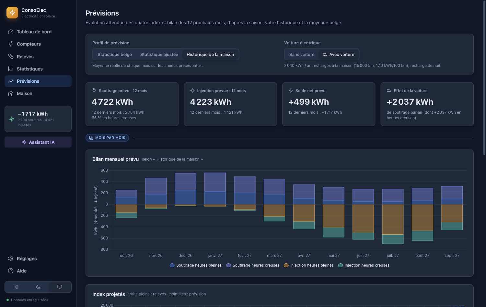
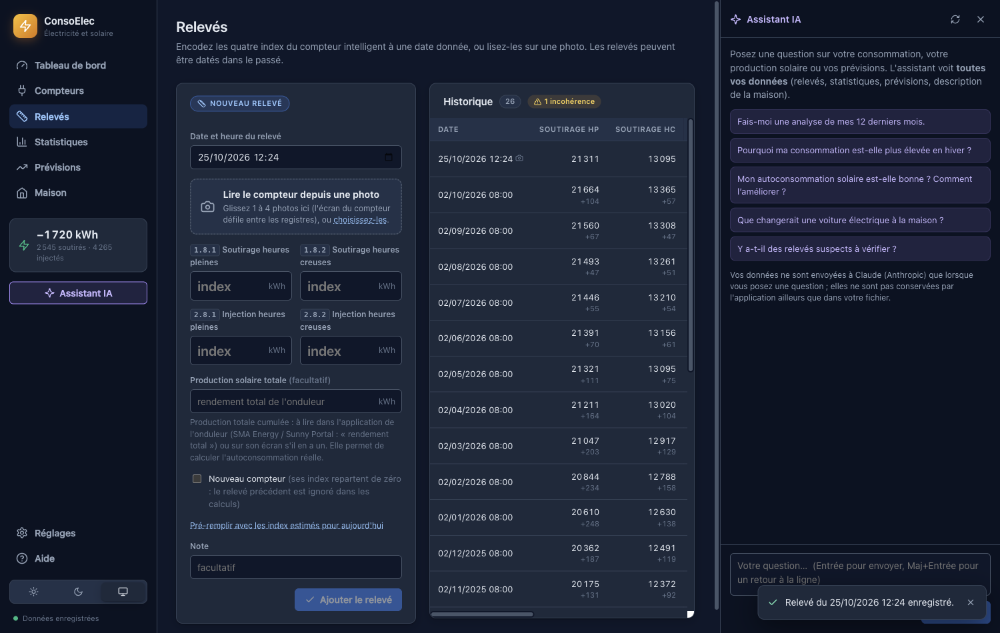

# Guide utilisateur de ConsoElec

ConsoElec suit la consommation et la production d'électricité d'une maison équipée de panneaux solaires. Il lit les index de votre **compteur intelligent**, calcule ce que la maison soutire et injecte chaque mois, la compare à une maison belge type et prévoit l'année à venir — avec ou sans voiture électrique. Un **assistant IA** (Claude) peut analyser toutes vos données.



## Présentation

Le principe est simple :

1. Vous décrivez **une seule fois** la maison : foyer, panneaux solaires, chauffage, voiture électrique éventuelle.
2. Vous encodez **de temps en temps un relevé** : les quatre index du compteur intelligent, à la main ou depuis une photo.
3. ConsoElec reconstitue la consommation et la production, mois par mois, et prévoit la suite.

> Les relevés peuvent être encodés **dans le passé**. Reprenez d'anciennes factures ou photos : plus l'historique est long, meilleures sont les prévisions.

## Installation

### macOS (Apple Silicon)

1. Ouvrez le fichier `consoelec-<version>-mac-arm64.dmg`.
2. Glissez **ConsoElec** dans le dossier **Applications**.
3. L'application n'est pas signée par un certificat Apple. Si macOS refuse de l'ouvrir (« endommagée » ou « développeur non identifié »), levez la quarantaine une fois dans le Terminal :

```bash
xattr -dr com.apple.quarantine /Applications/ConsoElec.app
```

### Windows

1. Lancez `consoelec-<version>-win-x64.exe`.
2. L'installeur n'est pas signé : Windows SmartScreen affiche un avertissement. Cliquez sur **Informations complémentaires** puis sur **Exécuter quand même**.
3. Choisissez le dossier d'installation. Aucun droit administrateur n'est nécessaire.

### Construire l'application soi-même

Depuis les sources, sur un Mac, avec Node.js 22 ou plus récent :

```bash
./release/build.sh       # crée release/consoelec-<version>-mac-arm64.dmg
./release/build-win.sh   # crée release/consoelec-<version>-win-x64.exe
```

Pour construire l'installeur Windows sur un Mac Apple Silicon, Rosetta 2 est nécessaire. Le script indique comment l'installer s'il manque.

## Premier démarrage

Au premier lancement, le tableau de bord propose :

- **Encoder un premier relevé** : le point de départ pour vos propres données.
- **Décrire ma maison** : puissance des panneaux, voiture électrique prévue…
- **Essayer avec des données de démo** : deux ans de relevés fictifs (6 kWc, famille de 4 personnes) pour découvrir toutes les fonctions. Effacez-les ensuite dans **Réglages → Tout effacer**.

La barre latérale donne accès aux pages. Elle affiche en permanence le **solde net des 12 derniers mois**, un bouton **Assistant IA**, le choix du thème et l'état de l'enregistrement.

## Comprendre le compteur intelligent

Votre compteur communicant affiche, en faisant défiler son écran, **quatre index cumulés en kWh** :

| Code | Index | Dans ConsoElec |
|------|-------|----------------|
| 1.8.1 | Énergie soutirée du réseau en **heures pleines** | Soutirage HP |
| 1.8.2 | Énergie soutirée du réseau en **heures creuses** | Soutirage HC |
| 2.8.1 | Énergie injectée sur le réseau en **heures pleines** | Injection HP |
| 2.8.2 | Énergie injectée sur le réseau en **heures creuses** | Injection HC |

En Wallonie, depuis le 1er janvier 2026, les heures creuses vont de 22 h à 7 h et de 11 h à 17 h : une installation solaire injecte donc surtout en heures creuses (2.8.2 nettement plus élevé que 2.8.1).

Sur un compteur Iskra IE.5 (comme celui d'AIEG), l'écran défile aussi sur les totaux **1.8.0** et **2.8.0** (sans tarif) ; ils ne sont pas encodés, mais ils servent à vérifier : 1.8.0 = 1.8.1 + 1.8.2. L'icône soleil désigne les heures pleines (tarif T1), l'icône lune les heures creuses (T2). Les index s'affichent avec 6 chiffres et 2 décimales (ex. `000705.94` = 705,94 kWh).

Deux précisions importantes :

- Le compteur mesure ce qui passe **entre la maison et le réseau**. Le **soutirage** n'est pas la consommation totale de la maison (une partie est couverte directement par les panneaux), et l'**injection** n'est pas la production totale des panneaux.
- Le **solde net** vaut soutirage − injection : sous zéro, la maison a injecté plus qu'elle n'a soutiré.

Pour connaître aussi la **production solaire totale**, l'**autoconsommation** et la **consommation réelle** de la maison, encodez en plus l'index de **production totale** de l'onduleur (champ facultatif de chaque relevé). Un onduleur SMA Sunny Tripower n'a pas d'écran, seulement des voyants : lisez le **rendement total** dans l'application *SMA Energy* ou dans *Sunny Portal*, ou déposez une capture d'écran de cette application à la place de la photo du compteur. ConsoElec calcule alors :

- autoconsommation = production − injection ;
- consommation de la maison = soutirage + autoconsommation ;
- taux d'autoconsommation = autoconsommation ÷ production ;
- autarcie = autoconsommation ÷ consommation de la maison.

Sans cet index, ces indicateurs ne sont pas affichés plutôt que devinés.

## Décrire la maison



La page **Maison** rassemble :

- le **foyer** (nombre de personnes, surface) ;
- le **chauffage** : chaudière au mazout (chauffage et eau chaude) et poêle à bois en appoint. Ils ne consomment pas d'électricité (hors circulateurs et brûleur) : la référence belge est celle d'un ménage **sans chauffage électrique**. La consommation de mazout se suit dans ConsoMazout ;
- les **panneaux solaires et l'onduleur** : nombre de panneaux et puissance de chacun (16 × 400 Wc = 6,4 kWc), puissance de l'onduleur en kVA (5 kVA), monophasé ou triphasé, inclinaison, orientation ;
- le **radiateur électrique d'appoint** branché de temps en temps sur le surplus solaire ;
- la **voiture électrique** (voir plus bas).

### L'onduleur écrête la production

Quand les panneaux peuvent produire plus que la puissance de l'onduleur (ici 6,4 kWc sur 5 kVA), l'onduleur **plafonne** sa production : c'est l'écrêtage. Il ne concerne que les jours très ensoleillés, surtout de mai à août ; avec 6,4 kWc sur 5 kVA, il fait perdre environ 2 % de la production annuelle (environ 100 kWh). La page Maison l'estime et ConsoElec le déduit de l'injection prévue. Un onduleur triphasé ne change rien à l'énergie produite : il répartit simplement l'injection sur les trois phases.

### Radiateur électrique d'appoint

Si vous chauffez parfois une pièce avec un radiateur électrique **pour consommer l'excédent de production**, indiquez sa puissance (2 kW par exemple), la période (d'octobre à avril) et la part des jours où vous le branchez (50 %). ConsoElec suppose qu'il fonctionne aux heures où le surplus solaire dépasse sa puissance :

- il consomme de l'électricité **autoproduite** : l'injection baisse du même nombre de kWh, le soutirage ne change pas ;
- il compte dans la **consommation de la maison** et dans l'**autoconsommation** ;
- il n'agit qu'en période de chauffe, et jamais au-delà du surplus disponible du mois ;
- avec 6,4 kWc, il absorbe quelques centaines de kWh par an : le surplus d'hiver est faible.

## Encoder un relevé



1. Ouvrez **Relevés**.
2. Vérifiez la **date et l'heure** (aujourd'hui par défaut ; vous pouvez choisir une date passée).
3. Saisissez les **quatre index** tels qu'affichés par le compteur (les décimales sont acceptées).
4. Ajoutez au besoin l'**index de production solaire** (rendement total de l'onduleur) et une note. Cochez **Nouveau compteur** si le compteur vient d'être remplacé : ses index repartent de zéro, et l'intervalle depuis le relevé précédent est ignoré au lieu d'être signalé comme une erreur.
5. Cliquez sur **Ajouter le relevé**.

Pendant la saisie, un **aperçu** indique de combien chaque index a progressé depuis le relevé précédent. Un index **plus bas** que celui d'un relevé voisin est signalé : faute de frappe, lecture erronée ou compteur remplacé.

Le bouton **Pré-remplir avec les index estimés** propose les valeurs attendues aujourd'hui : utile pour repérer une erreur de lecture.

Dans l'**historique**, chaque relevé montre l'augmentation de chaque index depuis le précédent. Un relevé peut être modifié ou supprimé ; les statistiques sont recalculées immédiatement.

### Relevé à partir d'une photo



Au lieu de taper les index, **déposez une photo** du compteur dans la zone prévue (ou cliquez sur « choisissez-les »). Comme l'écran du compteur fait défiler les registres, vous pouvez déposer **jusqu'à quatre photos** : une par écran.

1. Photographiez l'écran de près, sans reflet, de façon que le code (1.8.1, 1.8.2, 2.8.1, 2.8.2) et les chiffres soient nets.
2. Déposez les photos : Claude lit les index et **pré-remplit le formulaire**.
3. **Vérifiez chaque valeur** : celles dont la lecture est incertaine sont entourées en orange ou en rouge.
4. Corrigez au besoin, puis enregistrez.

Rien n'est enregistré sans votre validation, et la photo n'est pas conservée. Les photos au format HEIC des iPhone sont acceptées. La lecture demande l'application de bureau et une [clé API Claude](#assistant-ia).

## Tableau de bord

Le tableau de bord résume :

- le **solde net**, le **soutirage** (heures pleines et creuses) et l'**injection** des 12 derniers mois ;
- l'**autoconsommation** et l'**autarcie** (si l'index de l'onduleur est encodé) ;
- le **rythme des 30 derniers jours** comparé à ce qui est attendu ;
- la **prévision** des 12 prochains mois ;
- le **bilan mensuel** : soutirage vers le haut, injection vers le bas, empilés par tarif. Les barres pâles sont des mois incomplets ou prévus ;
- le **solde net cumulé**.

## Compteurs



La page **Compteurs** détaille les **quatre sous-compteurs** : index estimé aujourd'hui, dernier relevé, consommation des 7 et 30 derniers jours et des 12 derniers mois, courbe d'évolution (avec prévision en pointillés), et répartition heures pleines / heures creuses.

## Statistiques



- **Par saison** : soutirage et injection moyens de l'hiver, du printemps, de l'été et de l'automne, comparés à la référence belge.
- **Par mois** : comparaison des années, mois par mois, avec la référence en pointillés. L'indicateur est au choix : soutirage, injection, solde net, et — si l'index de l'onduleur est encodé — production solaire et consommation de la maison.
- **Détail par sous-compteur** et par année.

### Comment sont calculées les valeurs mensuelles ?

Entre deux relevés, l'augmentation de chaque index est **répartie jour par jour** selon le profil attendu de **ce registre** (soutirage HP, soutirage HC, injection HP, injection HC), tel que le calcule le modèle de la maison : plus de soutirage en hiver, beaucoup d'injection en été, presque aucune en décembre puisque la production est alors consommée sur place. Les totaux mensuels restent ainsi réalistes même avec des relevés espacés (voir la précision plus bas). Un mois n'entre dans les moyennes que s'il est **entièrement couvert** par des relevés ; les mois partiels sont affichés en pâle.

## Prévisions



ConsoElec projette les quatre index sur 18 mois et calcule le bilan des 12 prochains mois. Trois profils sont proposés :

- **Statistique belge** : une maison belge type avec vos réglages (consommation annuelle, puissance crête, heures creuses).
- **Statistique ajustée** : la référence recalée, registre par registre, sur ce que vos relevés montrent. Disponible dès deux relevés espacés de quelques semaines.
- **Historique de la maison** : la moyenne réelle de chaque mois sur les années précédentes. Disponible quand les douze mois sont couverts.

Le meilleur profil est utilisé par défaut ; vous pouvez en choisir un autre.

### Fiabilité des prévisions

- **Prudence avec peu de données** : la statistique ajustée ne reprend qu'une partie de l'écart observé, d'autant plus petite que les relevés couvrent peu de jours (un tiers après un mois, trois quarts après six mois, 86 % après un an). Quinze jours d'un hiver doux ne font donc pas prévoir une année entière.
- **Historique partiel** : dès neuf mois du calendrier mesurés, l'historique est utilisé ; les mois qui manquent sont complétés par la statistique ajustée.
- **Fiabilité observée** : la page Prévisions refait, pour chaque mois déjà mesuré, la prévision qu'on aurait faite avec les seuls relevés d'alors, puis la compare au résultat. Le tableau « Fiabilité observée » donne l'erreur moyenne de chaque profil, et le plus fiable est retenu dès que trois mois ont pu être testés.
- **Ordres de précision** (tests sur des maisons simulées jour par jour, météo aléatoire) : après 3 à 12 mois de relevés, le soutirage des 12 mois suivants est prévu à moins de 8 % près et l'injection à moins de 15 % près (davantage si les mois déjà relevés n'étaient pas représentatifs : un hiver très gris, par exemple) ; l'historique d'un an complet prévoit l'année suivante à moins de 6 % près pour le soutirage. Sans relevé, la statistique belge se trompe de la différence entre votre consommation réelle et la référence.

### Voiture électrique

Dans **Maison**, trois cas :

- **Pas de voiture** : situation actuelle.
- **Voiture prévue** : la page Prévisions propose de comparer **sans voiture** et **avec voiture**, et chiffre l'effet sur le soutirage (dont les heures creuses) et le solde net.
- **Voiture en service** : ses besoins sont inclus dans toutes les prévisions à partir de la date indiquée.

Il suffit d'indiquer la distance annuelle, la consommation du véhicule (kWh/100 km), la part de recharge faite à la maison et le moment de la recharge :

- **de nuit** : tout est soutiré en heures creuses ;
- **de jour** : la recharge absorbe d'abord le surplus solaire (donc moins d'injection), le reste est soutiré en heures pleines ;
- **mixte** : moitié-moitié.

Lorsque la voiture est déjà en service, la moyenne historique l'intègre peu à peu : attendez un an de données pour que le profil « Historique de la maison » la reflète pleinement.

## Assistant IA

Le bouton **Assistant IA** de la barre latérale ouvre un panneau, disponible sur toutes les pages. L'assistant voit **toutes vos données** (relevés, statistiques, prévisions, description de la maison) et répond à vos questions : analyse de l'année, comparaison à la référence, relevés suspects, impact d'une voiture électrique, pistes pour mieux consommer votre production solaire…



### Activer l'assistant

1. Créez le **coffre chiffré** (voir plus bas) s'il n'existe pas encore.
2. Créez une clé API sur [console.anthropic.com](https://console.anthropic.com/).
3. Dans **Réglages → Assistant IA**, collez-la et cliquez sur **Enregistrer**, puis sur **Tester la connexion**.
4. Choisissez le modèle Claude à utiliser (modifiable à tout moment).

### Confidentialité et coût

- La clé est rangée dans le **coffre chiffré par votre clé SSH**. Elle n'est **jamais exposée à la page**, n'est **pas exportée** et n'est **pas synchronisée** avec vos données.
- Vos données ne quittent l'ordinateur que **lorsque vous posez une question** ou déposez une photo : elles sont envoyées à Claude (Anthropic) via votre clé.
- Les appels sont **facturés par Anthropic** selon votre usage ; la lecture d'une photo et une question coûtent chacune quelques centimes au plus.
- L'assistant donne des ordres de grandeur et des pistes, pas de conseil financier ni juridique. Vérifiez ses chiffres sur le tableau de bord.

## Coffre chiffré par votre clé SSH

La clé API Claude et la clé de l'onduleur sont rangées dans un **coffre** chiffré (AES-256) par votre **clé SSH** personnelle, par exemple `~/.ssh/id_rsa`.

- **Création** : **Réglages → Coffre chiffré**, indiquez la clé SSH et sa phrase de passe, puis **Créer le coffre**. Une clé API enregistrée auparavant dans le Trousseau macOS y est reprise automatiquement.
- **Au démarrage**, ConsoElec demande la phrase de passe de la clé SSH. **Plus tard** laisse l'application utilisable sans l'assistant ni la lecture de l'onduleur ; le coffre peut être ouvert ensuite depuis les réglages.
- **Comment ça marche** : `ssh-keygen` signe un défi fixe avec votre clé ; cette signature (identique à chaque fois avec une clé RSA ou Ed25519) donne la clé de chiffrement. La phrase de passe n'est transmise qu'à `ssh-keygen`, sur ce Mac, et n'est enregistrée nulle part. Les clés ECDSA ne conviennent pas.
- **Sauvegarde** : le coffre (`secrets.vault`) n'est ni exporté ni synchronisé. Sur un autre Mac, recréez-le et ressaisissez les clés. Si vous changez de clé SSH, le coffre ne s'ouvre plus : recréez-le de même.

## Lecture de l'onduleur

ConsoElec peut lire directement un onduleur **SMA** (comme le Sunny Tripower STP5.0-3AV-40) sur votre réseau local, via son interface web (WebConnect) et la même connexion sécurisée que celle-ci.

1. L'onduleur doit être raccordé à votre Wi-Fi ou à votre box.
2. **Réglages → Onduleur** : cochez **Lire l'onduleur automatiquement**, vérifiez l'adresse (`SMA` + numéro de série + `.local`, ou son adresse IP) et saisissez la **clé WPA2-PSK** imprimée sur la plaque. Sur ce modèle, c'est elle qui ouvre le profil « Utilisateur ».
3. **Tester la connexion** affiche la puissance, la production du jour et l'index total.

Ensuite, tant que l'application est ouverte :
- le tableau de bord affiche la **production en direct**, rafraîchie chaque minute ;
- la **production du jour** est enregistrée dans vos données (une ligne par jour, exportée et fusionnée avec le reste) ;
- le champ « production solaire totale » d'un nouveau relevé est **pré-rempli** avec l'index de l'onduleur ;
- la page Maison affiche le **rendement mesuré** (kWh/kWc/an) à côté du réglage, après deux semaines de lectures.

Le certificat de l'onduleur est **épinglé** à la première connexion : si un autre appareil répond à la même adresse, la connexion est refusée. Après un remplacement de l'onduleur, utilisez **Oublier le certificat épinglé**.

## Widget macOS

« ConsoElec Widget » affiche la production solaire en direct sur le bureau ou dans le Centre de notifications. Il lit l'onduleur lui-même : ConsoElec n'a pas besoin d'être ouverte.

1. Installez-le avec `./widget/build.sh` (voir le README : Xcode et un identifiant Apple sont nécessaires), ou ouvrez **/Applications/ConsoElec Widget.app** s'il est déjà installé.
2. Dans la fenêtre de l'app, vérifiez l'adresse de l'onduleur (bouton **Rechercher**), saisissez la **clé WPA2-PSK** de la plaque et cliquez **Enregistrer**. La clé est rangée dans le **Trousseau macOS**, pas dans un fichier.
3. **Tester la lecture** affiche une lecture et l'aperçu du widget. Au premier accès, macOS demande l'autorisation d'accéder au réseau local : acceptez.
4. Ajoutez le widget : clic droit sur le bureau → **Modifier les widgets** → cherchez **ConsoElec** → choisissez le petit format (puissance et production du jour) ou le moyen (avec la courbe de la journée et l'index total).

Le widget se met à jour toutes les 5 à 15 minutes : c'est macOS qui fixe le rythme. Si l'onduleur ne répond pas (la nuit, Wi-Fi coupé), il garde la dernière lecture et affiche son heure. Comme ConsoElec, il épingle le certificat de l'onduleur à la première connexion.

## Partager entre plusieurs ordinateurs

Dans **Réglages → Données** :

1. **Exportez** (JSON) sur l'ordinateur qui contient les nouveaux relevés.
2. Copiez le fichier sur l'autre Mac (iCloud Drive, AirDrop, clé USB…).
3. **Importez**-le là : un aperçu indique les relevés à ajouter, les doublons et les conflits.

L'import **fusionne** : seuls les relevés absents sont ajoutés ; rien n'est modifié ni supprimé. Un relevé est reconnu comme déjà présent s'il a le même identifiant, ou la même date et les mêmes index. Si un même relevé a été modifié différemment sur les deux machines, la version locale est conservée. La description de la maison n'est reprise que si celle de cet ordinateur n'a jamais été modifiée. « Tout remplacer » reste possible, après confirmation.

### Fichiers CSV (Excel)

Les relevés s'exportent aussi en **CSV** (séparateur « ; », virgule décimale) et peuvent être **importés** depuis un tableau Excel : colonnes date, soutirage HP, soutirage HC, injection HP, injection HC, production PV (facultative) et note. Les lignes invalides sont signalées sans bloquer les autres, et l'import passe par la même fusion que le JSON. Des CSV d'analyse (consommation mensuelle, consommation entre relevés) sont également disponibles.

## Réglages et données de référence

- **Consommation de référence** : 2 800 / 3 500 / 4 500 kWh par an, ou valeur libre (ex. d'après votre dernière facture). Hors radiateur d'appoint et voiture, qui s'ajoutent.
- **Part hivernale** : part de la consommation qui suit l'hiver (éclairage, circulateurs, brûleur…). Le reste est constant toute l'année.
- **Présence en journée** : absents, partiellement ou à la maison. Elle décide de la part de la consommation qui coïncide avec le soleil, donc de l'autoconsommation (les week-ends sont toujours comptés « à la maison »).
- **Heures creuses** : cliquez sur les heures qui sont au tarif « nuit » (T2, icône lune du compteur), ou choisissez un préréglage :
  - **Wallonie depuis 2026** (par défaut) : 22 h-7 h **et 11 h-17 h**, tous les jours, week-ends compris dans cette règle. La production solaire de midi tombe alors en heures creuses : le modèle prévoit environ 77 % de l'injection et 30 % du soutirage en heures creuses ;
  - **ancien bihoraire** : 22 h-7 h, plus les week-ends entiers (environ 28 % de l'injection et 46 % du soutirage en heures creuses).

  Vérifiez la grille auprès de votre gestionnaire de réseau. Les index cumulés avant 2026 ont été comptés avec l'ancienne grille : les parts HP/HC du compteur se rapprochent de la nouvelle au fil des relevés.
- **Rendement des panneaux** : 900 kWh par kWc et par an par défaut, avant écrêtage de l'onduleur.

### Comment le modèle de référence est calculé

Pour chaque mois, ConsoElec simule des **journées types heure par heure** : jours dégagés, éclaircis et couverts, en semaine et le week-end. À chaque heure, le solaire alimente d'abord la maison, puis le radiateur d'appoint, puis la voiture ; l'onduleur écrête ce qui dépasse sa puissance ; le surplus est injecté, le manque est soutiré. Le tarif (heures pleines ou creuses) dépend de l'heure à laquelle chaque kWh est soutiré ou injecté. De là viennent le soutirage et l'injection attendus de chacun des quatre registres, mois par mois, ainsi que l'autoconsommation.

Sources et limites :

- Consommation : ~3 500 kWh/an pour 4 personnes sans chauffage électrique ; la VREG cite 3 305 kWh en moyenne en Flandre, les comparateurs 3 200 à 3 500 kWh pour 3 à 4 personnes. Valeur à ajuster d'après vos factures.
- Production : 850 à 1 000 kWh/kWc/an en Belgique pour une installation bien orientée (Bruxelles Environnement : 840 ; PVGIS donne davantage en Wallonie). La répartition mensuelle, la durée du jour et la fréquence des jours ensoleillés sont des ordres de grandeur issus des simulations PVGIS.
- Courbes de consommation de la journée : hypothèses types d'un ménage de 4 personnes (pointes du matin et du soir, consommation de fond de 30 %).
- Saisonnalité : degrés-jours 15/15 normaux à Uccle (IRM).

Ce sont des **ordres de grandeur** : dès qu'une année complète de relevés est disponible, la prévision « Historique de la maison » est privilégiée.

## Données et sauvegarde

Toutes les données sont dans un seul fichier JSON :

- macOS : `~/Library/Application Support/ConsoElec/consoelec.json`
- Windows : `%APPDATA%\ConsoElec\consoelec.json`

L'enregistrement est automatique ; la version précédente est conservée en `.bak` et restaurée si le fichier principal est illisible. **Réglages → Fichier de données → Afficher** l'ouvre dans le Finder.

## Questions fréquentes

**Un index est signalé « en baisse ».** Les index d'un compteur ne font que croître : vérifiez le chiffre saisi. Si le compteur a été **remplacé**, cochez **Nouveau compteur** sur le premier relevé du nouveau compteur : l'intervalle concerné est alors ignoré (la consommation pendant le remplacement n'est pas comptée), sans être signalé comme une erreur, et les relevés suivants repartent sur la base du nouveau compteur.

**La production solaire n'apparaît pas.** Le compteur ne mesure que l'injection. Encodez le rendement total de l'onduleur (application SMA Energy ou Sunny Portal pour un Sunny Tripower) dans vos relevés pour obtenir production, autoconsommation et consommation de la maison. L'autoconsommation est calculée sur les jours où cet index est connu ; il n'est pas nécessaire de l'encoder à chaque relevé.

**Faut-il relever chaque jour ?** Non : un relevé par mois suffit, la répartition journalière tient compte de la saison. Relevé le 1er de chaque mois, les mois sont exacts ; relevé à mi-mois, l'erreur sur un mois reste de l'ordre de 3 % pour le soutirage et 9 % pour l'injection ; tous les deux ou trois mois, elle monte à 5-6 % et 10-12 %. Les totaux sur l'année restent exacts. Au-delà de deux mois sans relevé, l'intervalle est signalé comme approximatif.

**L'assistant ou la lecture de photo ne fonctionnent pas.** Ils nécessitent l'application de bureau, le coffre déverrouillé, une clé API valide (Réglages → Tester la connexion) et une connexion internet.

**La lecture de l'onduleur échoue.** Vérifiez que le Mac et l'onduleur sont sur le même réseau, l'adresse dans les réglages et la clé WPA2-PSK (16 caractères, majuscules et minuscules). La nuit, la puissance est vide mais la production du jour et l'index total restent lisibles.
